  

  <h3>Reliable AI for Research and Operations</h3>
  
<em>AI systems that turn knowledge into action — bridging artificial intelligence and radiology.</em>

  

    
    
    
    
    
    
    
  

---

## About Gnostica AI

**Gnostica AI** is a health-tech company developing pioneering solutions in **MRI analysis** and **medical artificial intelligence**. By combining deep learning research and software engineering rigor directly with clinical expertise, we build fast, reliable, and workflow-ready AI analysis services and clinical decision support systems.

> **Our Mission:** To accelerate researchers and healthcare professionals with objective, millimetric imaging biomarkers that integrate seamlessly into workflows while upholding the highest standards of data privacy and security.

---

## Products & Roadmap — Shaping the Future of MRI

Starting with quantitative neuroimaging and expanding across MRI modalities, our platform is built for precision, repeatability, and privacy-first deployment:

| Solution | Stage | Overview | Deployment |
| :--- | :--- | :--- | :--- |
| **HippoFast RUO** | **Active** *(Phase 1)* | Automated 3D MRI hippocampal segmentation and volumetric analysis engineered for academic laboratories, biotechnology, and pharmaceutical R&D. Delivers millimetric precision and high repeatability. | Encrypted Cloud Service (SaaS) & On-Premise Edge Hardware |
| **HippoFast Clinical** | **In Development** *(Phase 2)* | Clinical volumetric analysis and structured reporting system *(pending regulatory clearance)* with automated background processing and direct institutional workflow integration. | Direct PACS Edge Integration & Secure Clinical Portal |

<em>Disclaimer: HippoFast RUO is intended strictly for academic studies and research use only (RUO). It is not intended for clinical diagnosis, patient monitoring, or treatment decisions.</em>

### Core Capabilities

- **Fully Automated 3D Segmentation** — End-to-end volumetric neuroimaging pipelines without manual contouring bottlenecks.
- **Millimetric Precision & Repeatability** — Consistent, objective morphometric measurements suited for longitudinal cohorts and clinical trials.
- **Privacy-First Architecture** — Mutual anonymization protocols, end-to-end encrypted transfers, and on-premise edge computing options for institutions keeping data in-house.
- **24/7 Automated Processing** — Streamlined four-step service workflow from request creation and protocol approval to encrypted upload and structured reporting.

---

## Recognition & Milestones

- **TÜBİTAK 1812 BiGG Investment Program (2026)** — Awarded the **Seal of Excellence** and qualified for investment under the 2026-1 call.
- **HealthTech Pre-Incubation Programme Demo Day (2026)** — **1st Prize Winner**, organized in collaboration with Teknopol Istanbul and Entertech Istanbul Technopark.

---

## Collaboration & Inquiries

We partner with academic research groups, clinical investigators, biotechnology teams, and healthcare institutions.

- **Website:** [gnostica.ai](https://gnostica.ai)
- **Email:** [info@gnostica.ai](mailto:info@gnostica.ai)
- **Updates & Publications:** [gnosticaAI.substack.com](https://gnosticaAI.substack.com/) · [LinkedIn](https://www.linkedin.com/company/gnosticaAI) · [X (@gnosticaAI)](https://x.com/gnosticaAI) · [Instagram](https://www.instagram.com/gnosticaAI)

---

## Brand & Media Assets

Official **Gnostica AI** logotypes and symbols maintained in this repository:

| Preview | Asset | Format | Links |
| :---: | :--- | :--- | :--- |
|  | **Primary Logotype (Animated)** | SVG | [View](../gnostica-logo-animated.svg) · [Raw](https://raw.githubusercontent.com/gnosticaAI/.github/main/gnostica-logo-animated.svg) |
|  | **Primary Logotype (Static)** | SVG | [View](../gnostica-logo.svg) · [Raw](https://raw.githubusercontent.com/gnosticaAI/.github/main/gnostica-logo.svg) |
|  | **Brand Symbol (Animated)** | SVG | [View](../gnostica-symbol-animated.svg) · [Raw](https://raw.githubusercontent.com/gnosticaAI/.github/main/gnostica-symbol-animated.svg) |
|  | **Brand Symbol (Static)** | SVG | [View](../gnostica-symbol.svg) · [Raw](https://raw.githubusercontent.com/gnosticaAI/.github/main/gnostica-symbol.svg) |
|  | **Brand Symbol (Monochrome)** | SVG | [View](../gnostica-symbol-bw.svg) · [Raw](https://raw.githubusercontent.com/gnosticaAI/.github/main/gnostica-symbol-bw.svg) |

Default Brand Covers: <a href="../default-16-9.jpg">16:9 Cover</a> · <a href="../default-4-3.jpg">4:3 Cover</a> · <a href="../default-square.jpg">1:1 Square</a>
